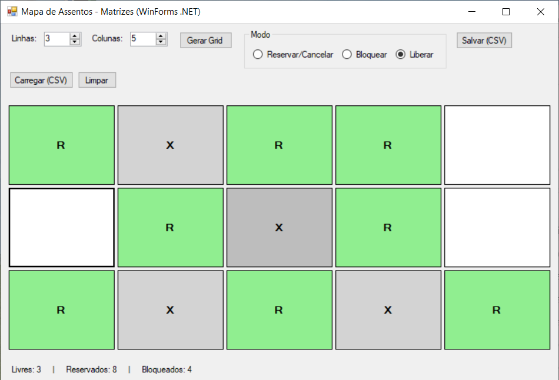
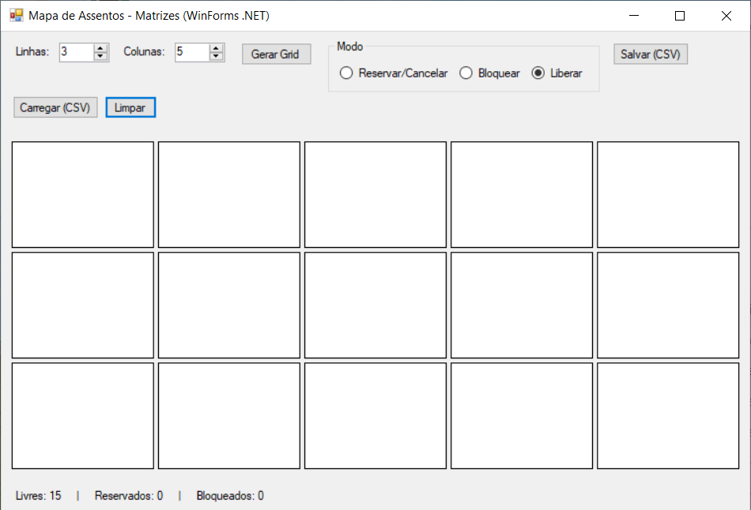
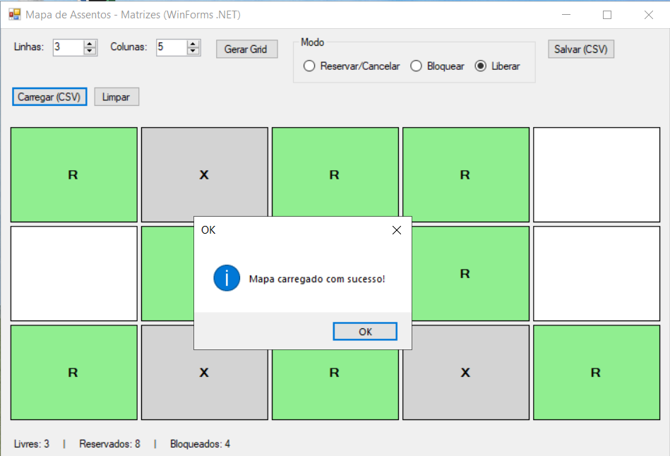
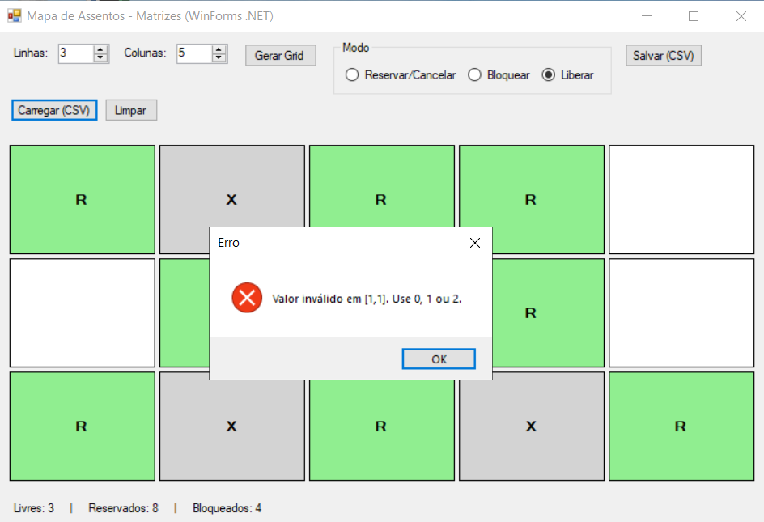
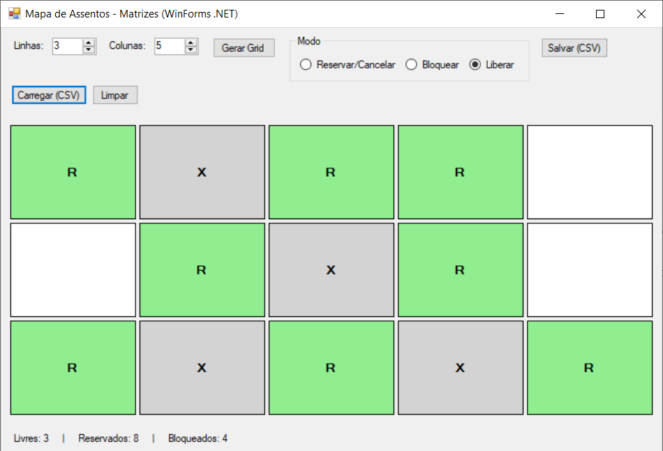

# Mapa de Assentos — C# Windows Forms

Aplicação acadêmica desenvolvida em C# para praticar matrizes bidimensionais, eventos de interface e persistência simples em arquivo CSV.

## Objetivo

Simular um mapa de assentos, permitindo criar uma grade configurável e controlar o estado de cada posição.

Estados utilizados:

- Livre;
- Reservado;
- Bloqueado.

## Funcionalidades

- Definição da quantidade de linhas e colunas;
- Geração de uma grade de assentos;
- Reserva e cancelamento de assentos;
- Bloqueio e liberação de assentos;
- Contadores de assentos livres, reservados e bloqueados;
- Salvamento do mapa em CSV;
- Carregamento de um mapa salvo;
- Limpeza do mapa, retornando todos os assentos para o estado Livre.

## Conceitos praticados

O projeto utiliza duas matrizes:

`SeatState[,] _mapa` representa o estado de cada assento.

`Button[,] _botoes` mantém a relação entre a matriz e os botões exibidos na interface.

A enumeração `SeatState` organiza os estados da aplicação:

- `0` — Livre;
- `1` — Reservado;
- `2` — Bloqueado.

## Regras principais

- Um assento bloqueado não pode ser reservado diretamente;
- Para alterar um assento bloqueado, é necessário usar o modo Liberar;
- O modo Reservar/Cancelar alterna entre Livre e Reservado;
- O grid aceita de 2 a 30 linhas e de 2 a 30 colunas.

## Formato do CSV

O arquivo salvo utiliza ponto e vírgula como separador:

```csv
3;4
0;0;1;0
2;0;0;0
0;1;0;2
```

A primeira linha informa a quantidade de linhas e colunas. As linhas seguintes armazenam os estados dos assentos.

## Tecnologias

- C#;
- Windows Forms;
- .NET Framework 4.7.2;
- Visual Studio 2022;
- Git e GitHub.

## Como executar

1. Abra o arquivo `MapaDeAssentos.sln` no Visual Studio.
2. Restaure as dependências, se solicitado.
3. Compile e execute o projeto.
4. Gere o grid e teste os modos de reserva, bloqueio e liberação.
5. Teste também o salvamento e o carregamento do CSV.

## Limites atuais

Este é um projeto acadêmico de estudo. Os dados são mantidos durante a execução e podem ser persistidos manualmente em CSV; não há banco de dados nem autenticação.

## Aprendizados

O projeto ajudou a praticar a relação entre dados, interface e regras de negócio em uma aplicação desktop. Também reforçou o uso de matrizes, eventos, validação de entradas e persistência simples em arquivo.

## Validação da importação CSV

O arquivo inteiro é validado antes de substituir o mapa atual. Cabeçalho e corpo devem conter exatamente as dimensões declaradas, entre 2 e 30, e apenas estados 0, 1 ou 2. Arquivos rejeitados preservam o mapa atual. Após uma importação válida, os seletores de linhas e colunas acompanham o tamanho importado.

### Testes de regressão

Execute `tests/Run-MapaCsvTests.ps1` no Windows com .NET Framework instalado. Os testes validam limites, estrutura e estados sem abrir a interface.

Após compilar em Release, execute `tests/Run-MapaFormTests.ps1`. Os 17 testes de integração abrem um formulário real e verificam reservas, cores, contadores, rejeição de CSV inválido sem perda do estado, atualização das dimensões e salvamento/reabertura em arquivo temporário. Esses testes reutilizam as mesmas rotinas chamadas pelos botões de carregar e salvar.

O workflow `Mapa de Assentos` compila o projeto para .NET Framework 4.7.2 no Windows e executa as duas suítes em cada PR que altera este projeto. Erros e avisos de compilação impedem a aprovação da verificação.

Na aplicação, reserve um assento e tente importar um CSV com um estado inválido na última célula. Confirme que assentos, contadores e dimensões permanecem iguais. Depois importe um CSV válido de tamanho diferente e confira os seletores, contadores e o salvamento/reabertura. A validação manual e as capturas reais estão registradas a seguir.


## Evidências de funcionamento

Capturas reais feitas pelo autor em 18/10/2026. A sequência abaixo utiliza uma grade de 3 linhas e 5 colunas: 3 assentos livres, 8 reservados e 4 bloqueados.



<details>
<summary>Ver limpeza, recuperação do CSV e rejeição de arquivo inválido</summary>









</details>

### Testes manuais realizados

| Cenário | Procedimento | Resultado observado |
| --- | --- | --- |
| Grade inicial | Gerar 3 linhas e 4 colunas | 12 livres, nenhum reservado ou bloqueado |
| Estados e contadores | Reservar e bloquear posições em uma grade 4 × 5 | 6 livres + 11 reservados + 3 bloqueados = 20 posições; cenário anterior, separado da sequência CSV |
| Assento bloqueado | Tentar reservar diretamente uma posição bloqueada | Aviso orienta usar Liberar; reserva direta impedida |
| Salvar e limpar | Salvar o mapa 3 × 5 e clicar em Limpar | CSV salvo; grade passa a 15 livres |
| Carregar CSV válido | Reabrir o arquivo salvo | Mesmas posições restauradas, com 3 livres, 8 reservados e 4 bloqueados |
| CSV inválido | Carregar um arquivo 2 × 2 contendo o estado 9 | Mensagem “Valor inválido em [1,1]. Use 0, 1 ou 2.” |
| Preservação após erro | Fechar o aviso de CSV inválido | Grade continua 3 × 5, nas mesmas posições e com os mesmos contadores |

CSV válido conferido com as imagens:

```csv
3;5
1;2;1;1;0
0;1;2;1;0
1;2;1;2;1
```

Arquivo utilizado para testar rejeição:

```csv
2;2
0;1
2;9
```

A sequência confirma também o uso manual dos diálogos de salvar e abrir arquivos. As capturas complementam os 19 testes CSV e os 17 testes de integração WinForms já versionados e aprovados no [GitHub Actions](https://github.com/rheylander/programadordesistemas-T02/actions/runs/39181602969). Esta rodada acrescenta documentação e imagens; não altera as regras da aplicação.
